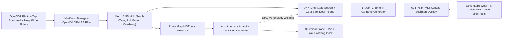

# Build Spec 01: **BetaCrux** — Universal Bouldering Grade Calibrator & 60 FPS Biomechanical Stickman Beta Engine

- **Primary Track**: **Track 03 — Voice, Vision & Generative Media** (`1st £500 · 2nd £200`)
- **Target Bounties & Extra Prizes**:
  - **Best use of fal** (`$1,000 + merch`): `fal-ai/sam-3/image` zero-shot climbing hold & wall-volume segmentation
  - **Best ElevenLabs project** (`Scale tier`): Real-time WebRTC voice beta coach (`@elevenlabs/client` `clientTools`) with noise cancellation for chalk-handed climbers
  - **Extra Prize 07 — Headline Partner Adaption Labs** (`$1,000 credits each`): Trains the gym-agnostic **Universal Grade (`U-Grade`)** & **Personal Morphological Beta Alignment** (`Adaptive Data` + `AutoScientist`)
  - **Extra Prize 06 — Figma** (`£960 + merch`): Interactive wall overlay UI with 60 FPS animated stickman climber, crux heatmap, and Gym Sandbag Radar
- *(Alternative Track Option: Track 02 `Autonomous Agents` using `MongoDB Atlas` vector topology search + `Linkup £560` MoonBoard/Kilter scraper + `Adaption Labs`.)*

---

## 1. System Architecture



---

## 2. Repository Structure & Dependencies

```text
betacrux/
├── README.md
├── backend/
│   ├── requirements.txt
│   ├── .env.example
│   ├── main.py                       # FastAPI entrypoint (/segment, /solve-beta, /log-feedback, /voice-token)
│   ├── hold_extractor.py             # fal-ai/sam-3/image + OpenCV CIE-LAB hold & grip classifier
│   ├── stickman_solver.py            # A* limb-state search + CoM physics + 17-joint IK solver
│   ├── universal_grade_adaption.py   # Adaption Labs U-Grade calibrator & personal beta alignment
│   └── seed_data/
│       ├── moonboard_2019_benchmarks.csv
│       └── precached_walls/          # 3 London gym walls + 2 MoonBoard problems pre-segmented
└── frontend/
    ├── package.json
    ├── .env.local.example
    └── src/
        ├── app/page.tsx              # Main Split Studio: Wall Canvas + Grade Radar + Beta Timeline
        ├── components/
        │   ├── StickmanCanvas.tsx    # 60 FPS interpolated stickman + hold masks + crux vector overlay
        │   ├── MorphologySliders.tsx # Height (cm), Ape Index (cm), Overhang Angle (deg)
        │   ├── UniversalGradeCard.tsx# U-V Grade, Font Grade, Gym Sandbag Delta gauge
        │   └── VoiceBetaCoach.tsx    # @elevenlabs/client WebRTC session + clientTools
        └── types/betacrux.ts
```

### `backend/requirements.txt`
```text
fastapi>=0.115.0
uvicorn[standard]>=0.32.0
pydantic>=2.9.0
fal-client>=0.5.0
opencv-python-headless>=4.10.0
numpy>=1.26.0
scipy>=1.14.0
httpx>=0.27.0
adaption>=0.7.0
python-dotenv>=1.0.1
```

### `frontend/package.json` (key dependencies)
```json
{
  "dependencies": {
    "next": "^14.2.0",
    "react": "^18.3.0",
    "react-dom": "^18.3.0",
    "@elevenlabs/client": "^0.1.0",
    "lucide-react": "^0.450.0"
  }
}
```

### `.env.example`
```bash
FAL_KEY=your_fal_key
ADAPTION_API_KEY=pt_live_your_adaption_key
ELEVENLABS_API_KEY=your_elevenlabs_key
ELEVENLABS_AGENT_ID=your_convai_agent_id
```

---

## 3. Core Algorithms & Starter Code (Copy-Paste Ready)

### 3.1 `backend/hold_extractor.py` — `fal-ai/sam-3/image` + CIE-LAB Clustering + Grip Classifier
Calls `fal-ai/sam-3/image` to isolate climbing holds without manually painting masks, filters holds matching the tapped/selected problem color in perceptually uniform CIE-LAB space ($\Delta E < \tau$), classifies hold geometry (`jug`, `crimp`, `sloper`, `pinch`, `volume`, `foothold`), and normalizes coordinates into meters using a calibrated wall height / reference hold scale.

```python
import base64
import math
from typing import Literal
import cv2
import fal_client
import numpy as np
from pydantic import BaseModel


GripType = Literal["jug", "crimp", "sloper", "pinch", "foothold", "volume"]


class HoldNode(BaseModel):
    id: int
    x_norm: float       # 0..1 image horizontal
    y_norm: float       # 0..1 image vertical (0 = top)
    x_m: float          # metric horizontal (meters, center=0)
    y_m: float          # metric vertical (meters, bottom=0)
    area_cm2: float
    aspect_ratio: float
    grip_type: GripType
    incut_score: float  # 0.1 (bad sloper/micro-crimp) .. 1.0 (bucket jug)
    pull_angle_deg: float  # 0=downpull, 90=sidepull left, -90=sidepull right, 180=undercling
    is_start: bool = False
    is_finish: bool = False


def _mean_lab_of_mask(img_lab: np.ndarray, mask: np.ndarray) -> np.ndarray:
    pts = img_lab[mask > 0]
    if len(pts) == 0:
        return np.array([0.0, 128.0, 128.0])
    return pts.mean(axis=0)


def _classify_hold(mask: np.ndarray, img_gray: np.ndarray, wall_height_m: float, img_h: int) -> dict:
    ys, xs = np.where(mask > 0)
    if len(xs) < 12:
        return None
    x_min, x_max = int(xs.min()), int(xs.max())
    y_min, y_max = int(ys.min()), int(ys.max())
    w = max(1, x_max - x_min)
    h = max(1, y_max - y_min)
    aspect = w / h

    px_to_m = wall_height_m / float(img_h)
    area_m2 = float(len(xs)) * (px_to_m ** 2)
    area_cm2 = area_m2 * 10000.0

    # Estimate upper-edge shadow contrast as a proxy for hold incutness (positive lip casts sharper top contrast)
    pad_top = max(0, y_min - 4)
    top_strip = img_gray[pad_top:y_min + 2, x_min:x_max + 1]
    bot_strip = img_gray[max(0, y_max - 2):min(img_h, y_max + 4), x_min:x_max + 1]
    top_mean = float(top_strip.mean()) if top_strip.size else 128.0
    bot_mean = float(bot_strip.mean()) if bot_strip.size else 128.0
    incut_proxy = np.clip(0.5 + (top_mean - bot_mean) / 140.0, 0.15, 0.98)

    # Heuristic grip typing
    if area_cm2 > 380:
        grip_type: GripType = "volume"
        incut = 0.72
    elif area_cm2 < 24:
        grip_type = "foothold"
        incut = 0.28
    elif aspect > 2.2 and h * px_to_m < 0.045:
        grip_type = "crimp"
        incut = float(np.clip(incut_proxy * 0.65, 0.20, 0.72))
    elif aspect < 0.65:
        grip_type = "pinch"
        incut = float(np.clip(incut_proxy * 0.78, 0.30, 0.80))
    elif incut_proxy < 0.42:
        grip_type = "sloper"
        incut = float(incut_proxy)
    else:
        grip_type = "jug"
        incut = float(np.clip(incut_proxy + 0.15, 0.65, 0.98))

    # Dominant principal axis for pull direction
    coords = np.column_stack([xs - xs.mean(), ys - ys.mean()]).astype(np.float32)
    cov = np.cov(coords, rowvar=False) if len(coords) > 2 else np.eye(2)
    eigvals, eigvecs = np.linalg.eigh(cov)
    major = eigvecs[:, -1]
    angle_deg = float(math.degrees(math.atan2(major[1], major[0])))
    pull_angle = 0.0 if abs(angle_deg) < 35 else (90.0 if major[0] > 0 else -90.0)

    return {
        "cx": float(xs.mean()),
        "cy": float(ys.mean()),
        "area_cm2": round(area_cm2, 1),
        "aspect_ratio": round(aspect, 2),
        "grip_type": grip_type,
        "incut_score": round(incut, 2),
        "pull_angle_deg": pull_angle,
    }


def extract_holds_with_sam3(
    image_bytes: bytes,
    target_point_norm: tuple[float, float],
    hold_color_prompt: str = "climbing holds",
    wall_height_m: float = 4.2,
    lab_delta_e_thresh: float = 28.0,
) -> list[HoldNode]:
    arr = np.frombuffer(image_bytes, dtype=np.uint8)
    bgr = cv2.imdecode(arr, cv2.IMREAD_COLOR)
    img_h, img_w = bgr.shape[:2]
    lab = cv2.cvtColor(bgr, cv2.COLOR_BGR2LAB).astype(np.float32)
    gray = cv2.cvtColor(bgr, cv2.COLOR_BGR2GRAY).astype(np.float32)

    # Sample target hold color at user-tapped coordinate (5x5 patch median in CIE-LAB)
    tx = int(np.clip(target_point_norm[0] * img_w, 3, img_w - 4))
    ty = int(np.clip(target_point_norm[1] * img_h, 3, img_h - 4))
    target_lab = np.median(lab[ty - 3:ty + 4, tx - 3:tx + 4].reshape(-1, 3), axis=0)

    # Call fal-ai/sam-3/image via base64 data URI
    b64 = base64.b64encode(image_bytes).decode("utf-8")
    data_uri = f"data:image/jpeg;base64,{b64}"

    sam_result = fal_client.subscribe(
        "fal-ai/sam-3/image",
        arguments={
            "image_url": data_uri,
            "prompt": f"{hold_color_prompt}",
            "return_multiple_masks": True,
        },
    )

    # Fallback / mask decoding: combine SAM3 returned masks or color-guided connected components
    holds: list[HoldNode] = []
    candidate_masks = []
    for m_info in sam_result.get("masks", []):
        m_url = m_info.get("url")
        if m_url:
            import httpx
            m_resp = httpx.get(m_url, timeout=15.0)
            m_arr = cv2.imdecode(np.frombuffer(m_resp.content, np.uint8), cv2.IMREAD_GRAYSCALE)
            if m_arr is not None:
                m_bin = cv2.resize(m_arr, (img_w, img_h)) > 127
                candidate_masks.append(m_bin.astype(np.uint8))

    # Color-consistency filter using Delta-E on chrominance channels (a*, b*) + weighted L*
    if not candidate_masks:
        # Deterministic CIE-LAB color segmentation backup if SAM returns composite overlay
        diff = np.linalg.norm((lab - target_lab) * np.array([0.45, 1.0, 1.0]), axis=2)
        color_bin = (diff < lab_delta_e_thresh).astype(np.uint8) * 255
        kernel = cv2.getStructuringElement(cv2.MORPH_ELLIPSE, (5, 5))
        color_bin = cv2.morphologyEx(color_bin, cv2.MORPH_OPEN, kernel)
        num_labels, labels = cv2.connectedComponents(color_bin)
        for lbl in range(1, num_labels):
            candidate_masks.append((labels == lbl).astype(np.uint8))

    px_to_m = wall_height_m / float(img_h)
    idx = 0
    for mask in candidate_masks:
        mlab = _mean_lab_of_mask(lab, mask)
        delta_e = float(np.linalg.norm((mlab - target_lab) * np.array([0.45, 1.0, 1.0])))
        if delta_e > lab_delta_e_thresh:
            continue
        meta = _classify_hold(mask, gray, wall_height_m, img_h)
        if meta is None:
            continue
        x_m = (meta["cx"] - img_w * 0.5) * px_to_m
        y_m = (img_h - meta["cy"]) * px_to_m
        holds.append(HoldNode(
            id=idx,
            x_norm=round(meta["cx"] / img_w, 4),
            y_norm=round(meta["cy"] / img_h, 4),
            x_m=round(x_m, 3),
            y_m=round(y_m, 3),
            area_cm2=meta["area_cm2"],
            aspect_ratio=meta["aspect_ratio"],
            grip_type=meta["grip_type"],
            incut_score=meta["incut_score"],
            pull_angle_deg=meta["pull_angle_deg"],
        ))
        idx += 1

    # Tag lowest accessible holds as start and highest hold as finish
    holds.sort(key=lambda h: h.y_m)
    if holds:
        holds[0].is_start = True
        if len(holds) > 1 and holds[1].y_m < holds[0].y_m + 0.45:
            holds[1].is_start = True
        holds[-1].is_finish = True
    return holds
```

---

### 3.2 `backend/stickman_solver.py` — A* 4-Limb State Search + CoM Torque Physics + 17-Joint IK
Models the climber accurately by `height_cm` and `ape_index_cm`, discovers real climbing techniques (**flagging**, **heel hooks**, **drop knees**, **dyno/deadpoint**) via physics costs, and produces 17-joint keyframes ready for 60 FPS HTML5 Canvas playback.

```python
import heapq
import math
from dataclasses import dataclass
import numpy as np
from pydantic import BaseModel
from hold_extractor import HoldNode


class StickmanKeyframe(BaseModel):
    step_idx: int
    move_description: str
    technique_tag: str  # "reach", "flag_left", "flag_right", "heel_hook", "drop_knee", "deadpoint", "match"
    crux_score: float   # 0..1 difficulty of this specific transition
    joints: dict[str, list[float]]  # Normalized [x_norm, y_norm] for 17 joints
    com: list[float]                # Center of mass [x_norm, y_norm]
    active_holds: dict[str, int | None]  # LH, RH, LF, RF hold IDs


@dataclass(frozen=True)
class LimbState:
    lh: int
    rh: int
    lf: int | None  # None = flagging leg in free space!
    rf: int | None
    flag_bias: int  # -1 left flag, 0 neutral, +1 right flag


def _solve_2bone_ik(
    root: np.ndarray, target: np.ndarray, l1: float, l2: float, bend_dir: float = 1.0
) -> np.ndarray:
    """Analytical 2-bone inverse kinematics for elbow/knee placement."""
    diff = target - root
    d = float(np.linalg.norm(diff))
    d_clamped = float(np.clip(d, abs(l1 - l2) + 1e-4, l1 + l2 - 1e-4))
    u = diff / (d + 1e-8)
    perp = np.array([-u[1], u[0]]) * bend_dir
    cos_a = np.clip((l1**2 + d_clamped**2 - l2**2) / (2 * l1 * d_clamped), -1.0, 1.0)
    sin_a = math.sqrt(max(0.0, 1.0 - cos_a**2))
    return root + l1 * (cos_a * u + sin_a * perp)


def _compute_skeleton_joints(
    holds_by_id: dict[int, HoldNode],
    state: LimbState,
    height_m: float,
    ape_m: float,
    wall_height_m: float,
    img_aspect: float = 0.75,
) -> tuple[dict[str, list[float]], list[float]]:
    """Convert 4-limb hold state into 17 articulated 2D Stickman joint coords in [0..1] canvas space."""
    lh = np.array([holds_by_id[state.lh].x_m, holds_by_id[state.lh].y_m])
    rh = np.array([holds_by_id[state.rh].x_m, holds_by_id[state.rh].y_m])

    torso_len = 0.30 * height_m
    upper_arm = 0.186 * (height_m + ape_m * 0.5)
    forearm = 0.146 * (height_m + ape_m * 0.5)
    thigh = 0.245 * height_m
    shin = 0.246 * height_m
    shoulder_w = 0.22 * height_m
    hip_w = 0.14 * height_m

    # Estimate pelvis / CoM position below hand midpoint and above feet
    hand_mid = 0.5 * (lh + rh)
    if state.lf is not None and state.rf is not None:
        lf = np.array([holds_by_id[state.lf].x_m, holds_by_id[state.lf].y_m])
        rf = np.array([holds_by_id[state.rf].x_m, holds_by_id[state.rf].y_m])
        foot_mid = 0.5 * (lf + rf)
    elif state.lf is not None:
        lf = np.array([holds_by_id[state.lf].x_m, holds_by_id[state.lf].y_m])
        rf = lf + np.array([0.45 * height_m * state.flag_bias, -0.25 * height_m])
        foot_mid = lf + np.array([0.15 * state.flag_bias, 0.0])
    elif state.rf is not None:
        rf = np.array([holds_by_id[state.rf].x_m, holds_by_id[state.rf].y_m])
        lf = rf + np.array([0.45 * height_m * state.flag_bias, -0.25 * height_m])
        foot_mid = rf + np.array([0.15 * state.flag_bias, 0.0])
    else:
        foot_mid = hand_mid - np.array([0.0, 0.85 * height_m])
        lf = foot_mid + np.array([-0.25, 0.0])
        rf = foot_mid + np.array([0.25, 0.0])

    # Place CoM & pelvis satisfying torso reach
    pelvis = np.array([
        0.55 * foot_mid[0] + 0.45 * hand_mid[0],
        max(foot_mid[1] + 0.28 * height_m, hand_mid[1] - 0.52 * height_m),
    ])
    neck = pelvis + np.array([(hand_mid[0] - pelvis[0]) * 0.45, torso_len])
    head = neck + np.array([0.0, 0.12 * height_m])

    l_shoulder = neck + np.array([-shoulder_w * 0.5, -0.02])
    r_shoulder = neck + np.array([shoulder_w * 0.5, -0.02])
    l_hip = pelvis + np.array([-hip_w * 0.5, 0.0])
    r_hip = pelvis + np.array([hip_w * 0.5, 0.0])

    l_elbow = _solve_2bone_ik(l_shoulder, lh, upper_arm, forearm, bend_dir=-1.0)
    r_elbow = _solve_2bone_ik(r_shoulder, rh, upper_arm, forearm, bend_dir=1.0)
    l_knee = _solve_2bone_ik(l_hip, lf, thigh, shin, bend_dir=-1.0)
    r_knee = _solve_2bone_ik(r_hip, rf, thigh, shin, bend_dir=1.0)

    wall_w_m = wall_height_m * img_aspect

    def to_norm(pt: np.ndarray) -> list[float]:
        return [
            round(float(pt[0] / wall_w_m + 0.5), 4),
            round(float(1.0 - pt[1] / wall_height_m), 4),
        ]

    joints_m = {
        "head": head, "neck": neck,
        "l_shoulder": l_shoulder, "r_shoulder": r_shoulder,
        "l_elbow": l_elbow, "r_elbow": r_elbow,
        "l_wrist": lh, "r_wrist": rh,
        "pelvis": pelvis,
        "l_hip": l_hip, "r_hip": r_hip,
        "l_knee": l_knee, "r_knee": r_knee,
        "l_ankle": lf, "r_ankle": rf,
    }
    com = 0.55 * pelvis + 0.45 * neck
    return {k: to_norm(v) for k, v in joints_m.items()}, to_norm(com)


def solve_stickman_beta(
    holds: list[HoldNode],
    height_cm: float = 175.0,
    ape_index_cm: float = 2.0,
    wall_angle_deg: float = 20.0,
    wall_height_m: float = 4.2,
    heel_hook_affinity: float = 1.0,  # Tuned per climber by Adaption AutoScientist DPO!
) -> list[StickmanKeyframe]:
    if len(holds) < 3:
        return []

    height_m = height_cm / 100.0
    ape_m = ape_index_cm / 100.0
    max_arm_reach = 0.44 * (height_m + ape_m * 0.5)
    max_span = 0.96 * (height_m + ape_m)
    max_step_height = 0.58 * height_m
    overhang_factor = 1.0 + max(0.0, wall_angle_deg) / 45.0

    holds_by_id = {h.id: h for h in holds}
    starts = [h for h in holds if h.is_start] or [holds[0]]
    finish_id = max(holds, key=lambda h: h.y_m).id
    init = LimbState(
        lh=starts[0].id,
        rh=starts[min(1, len(starts) - 1)].id,
        lf=starts[0].id,
        rf=None,
        flag_bias=1,
    )

    def dist(a_id: int, b_id: int) -> float:
        ha, hb = holds_by_id[a_id], holds_by_id[b_id]
        return math.hypot(ha.x_m - hb.x_m, ha.y_m - hb.y_m)

    def transition_cost(s: LimbState, ns: LimbState, moved_limb: str) -> tuple[float, str]:
        lh_h, rh_h = holds_by_id[ns.lh], holds_by_id[ns.rh]
        hand_span = dist(ns.lh, ns.rh)
        if hand_span > max_span:
            return 1e9, "impossible"

        # Barn-door torque proxy: horizontal offset between active hand-pair and support feet
        hand_cx = 0.5 * (lh_h.x_m + rh_h.x_m)
        foot_xs = [holds_by_id[f].x_m for f in (ns.lf, ns.rf) if f is not None]
        if not foot_xs:
            return 1e9, "no_feet"
        foot_cx = sum(foot_xs) / len(foot_xs)
        barn_door = abs(hand_cx - foot_cx)

        # Automatic flag reduces barn-door penalty when flagging opposite the reach side
        tag = f"move_{moved_limb}"
        if ns.lf is None or ns.rf is None:
            barn_door *= 0.45
            tag = "flag_right" if ns.rf is None else "flag_left"

        # Hold quality penalty (amplified by wall overhang angle)
        grip_pen = ((1.1 - lh_h.incut_score) + (1.1 - rh_h.incut_score)) * overhang_factor

        # Heel hook detection when foot is near or above pelvis/hand height
        foot_y = max(holds_by_id[f].y_m for f in (ns.lf, ns.rf) if f is not None)
        if foot_y > min(lh_h.y_m, rh_h.y_m) - 0.35:
            tag = "heel_hook"
            grip_pen *= (0.75 * heel_hook_affinity)

        if moved_limb in ("lh", "rh"):
            prev_id = s.lh if moved_limb == "lh" else s.rh
            new_id = ns.lh if moved_limb == "lh" else ns.rh
            move_d = dist(prev_id, new_id)
            if move_d > max_arm_reach * 1.45:
                return 1e9, "too_far"
            if move_d > max_arm_reach * 1.05:
                tag = "deadpoint"
                move_d *= 1.65
            cost = 1.2 * move_d + 0.9 * grip_pen + 1.4 * barn_door
        else:
            prev_f = s.lf if moved_limb == "lf" else s.rf
            new_f = ns.lf if moved_limb == "lf" else ns.rf
            step_d = dist(prev_f, new_f) if (prev_f is not None and new_f is not None) else 0.25
            if step_d > max_step_height * 1.35:
                return 1e9, "high_step_blocked"
            cost = 0.55 * step_d + 0.5 * barn_door

        return max(0.05, cost), tag

    # A* search over feasible hold transitions
    pq = [(0.0, 0, init)]
    g_score = {init: 0.0}
    came_from: dict[LimbState, tuple[LimbState, str, float]] = {}
    counter = 0
    goal_state = None

    while pq and counter < 8000:
        _, _, cur = heapq.heappop(pq)
        if cur.lh == finish_id and cur.rh == finish_id:
            goal_state = cur
            break
        if cur.lh == finish_id or cur.rh == finish_id:
            # Allow finishing match
            goal_state = LimbState(finish_id, finish_id, cur.lf, cur.rf, cur.flag_bias)
            came_from[goal_state] = (cur, "match_finish", 0.35)
            break

        cur_hand_y = max(holds_by_id[cur.lh].y_m, holds_by_id[cur.rh].y_m)
        neighbors: list[tuple[LimbState, str]] = []

        # Candidate hand moves upward or laterally
        for h in holds:
            if h.y_m >= cur_hand_y - 0.35:
                if h.id != cur.lh and dist(h.id, cur.lh) <= max_arm_reach * 1.4:
                    neighbors.append((LimbState(h.id, cur.rh, cur.lf, cur.rf, 1 if h.x_m < holds_by_id[cur.rh].x_m else -1), "lh"))
                if h.id != cur.rh and dist(h.id, cur.rh) <= max_arm_reach * 1.4:
                    neighbors.append((LimbState(cur.lh, h.id, cur.lf, cur.rf, -1 if h.x_m > holds_by_id[cur.lh].x_m else 1), "rh"))
            # Candidate foot moves (including heel hooks up to hip/chest level)
            if h.y_m <= cur_hand_y + 0.05:
                if h.id != cur.lf:
                    neighbors.append((LimbState(cur.lh, cur.rh, h.id, cur.rf, cur.flag_bias), "lf"))
                if h.id != cur.rf:
                    neighbors.append((LimbState(cur.lh, cur.rh, cur.lf, h.id, cur.flag_bias), "rf"))

        # Candidate flagging states
        if cur.lf is not None and cur.rf is not None:
            neighbors.append((LimbState(cur.lh, cur.rh, cur.lf, None, 1), "rf"))
            neighbors.append((LimbState(cur.lh, cur.rh, None, cur.rf, -1), "lf"))

        for nxt, limb in neighbors:
            step_cost, tag = transition_cost(cur, nxt, limb)
            if step_cost >= 1e8:
                continue
            tentative = g_score[cur] + step_cost
            if tentative < g_score.get(nxt, 1e9):
                g_score[nxt] = tentative
                came_from[nxt] = (cur, tag, step_cost)
                h_rem = max(0.0, holds_by_id[finish_id].y_m - max(holds_by_id[nxt.lh].y_m, holds_by_id[nxt.rh].y_m))
                counter += 1
                heapq.heappush(pq, (tentative + 1.4 * h_rem, counter, nxt))

    # Reconstruct keyframe sequence
    if goal_state is None:
        goal_state = max(g_score.keys(), key=lambda s: holds_by_id[s.lh].y_m + holds_by_id[s.rh].y_m)

    chain: list[tuple[LimbState, str, float]] = []
    curr = goal_state
    while curr in came_from:
        prev, tag, sc = came_from[curr]
        chain.append((curr, tag, sc))
        curr = prev
    chain.append((init, "start_position", 0.1))
    chain.reverse()

    max_sc = max((c[2] for c in chain), default=1.0) or 1.0
    keyframes: list[StickmanKeyframe] = []
    for idx, (st, tag, sc) in enumerate(chain):
        joints, com = _compute_skeleton_joints(holds_by_id, st, height_m, ape_m, wall_height_m)
        keyframes.append(StickmanKeyframe(
            step_idx=idx,
            move_description=f"Step {idx}: {tag.replace('_', ' ').title()} (LH:#{st.lh}, RH:#{st.rh})",
            technique_tag=tag,
            crux_score=round(min(1.0, sc / max(1.8, max_sc)), 2),
            joints=joints,
            com=com,
            active_holds={"LH": st.lh, "RH": st.rh, "LF": st.lf, "RF": st.rf},
        ))
    return keyframes
```

---

### 3.3 `backend/universal_grade_adaption.py` — Adaption Labs `U-Grade` & Gym Sandbag Index
Connects the physical route-graph features + climber solve difficulty into **Adaption Labs `Adaptive Data`** and **`AutoScientist`** (`instruction` for Universal Grade calibration against global MoonBoard/Kilter consensus grades, and `alignment` for personal stickman beta preferences).

```python
import io
import csv
import httpx
import numpy as np
from adaption import Adaption
from hold_extractor import HoldNode
from stickman_solver import StickmanKeyframe


class UniversalGradeReport(dict):
    pass


def compute_route_difficulty_vector(
    holds: list[HoldNode], keyframes: list[StickmanKeyframe], wall_angle_deg: float, height_cm: float
) -> dict:
    if not holds or not keyframes:
        return {"u_vgrade": 0.0, "font_grade": "3", "crux_move_idx": 0}

    incuts = [h.incut_score for h in holds if h.grip_type != "foothold"]
    mean_hardness = 1.0 - (sum(incuts) / max(1, len(incuts)))
    crux_kf = max(keyframes, key=lambda k: k.crux_score)
    peak_crux = crux_kf.crux_score

    # Base mechanical work + overhang + hold-incut model (anchored to MoonBoard/Kilter V0..V12 regression)
    raw_v = (
        0.5
        + 4.8 * mean_hardness
        + 3.6 * peak_crux
        + 0.065 * max(0.0, wall_angle_deg)
        + 0.14 * max(0, len(keyframes) - 5)
    )
    # Morpho normalization: reference climber = 175cm; short reach on wide spans raises true difficulty slightly
    u_v = round(float(np.clip(raw_v, 0.0, 13.0)), 1)
    font_map = ["4", "4+", "5", "5+", "6A", "6B", "6C", "7A", "7A+", "7B+", "7C+", "8A", "8A+", "8B"]
    font_grade = font_map[min(len(font_map) - 1, int(round(u_v)))]

    return {
        "universal_v_grade": u_v,
        "universal_font_grade": font_grade,
        "crux_step_idx": crux_kf.step_idx,
        "feature_summary": {
            "mean_hold_hardness": round(mean_hardness, 3),
            "peak_crux_torque": round(peak_crux, 3),
            "wall_angle_deg": wall_angle_deg,
            "move_count": len(keyframes),
            "climber_height_cm": height_cm,
        },
    }


def compute_sandbag_delta(universal_v_grade: float, gym_tagged_v_grade: float | None) -> dict:
    if gym_tagged_v_grade is None:
        return {"gym_delta": 0.0, "verdict": "Uncalibrated Gym Tag"}
    delta = round(universal_v_grade - gym_tagged_v_grade, 1)
    if delta >= 0.8:
        verdict = f"SANDBAGGED (+{delta}V harder than global MoonBoard/Kilter baseline)"
    elif delta <= -0.8:
        verdict = f"SOFT ({delta}V easier than global MoonBoard/Kilter baseline)"
    else:
        verdict = "ACCURATE (within +/- 0.7V of global consensus)"
    return {"gym_delta": delta, "verdict": verdict}


def push_climber_feedback_to_adaption(records: list[dict]) -> str:
    """Uploads real climber send/fail/perceived-grade trajectories to Adaption Adaptive Data & starts AutoScientist."""
    client = Adaption()
    buf = io.StringIO()
    writer = csv.DictWriter(buf, fieldnames=["instruction", "response"])
    writer.writeheader()
    for r in records:
        writer.writerow({
            "instruction": (
                f"Gym={r['gym_name']} WallAngle={r['wall_angle_deg']}deg "
                f"Height={r['height_cm']}cm Ape={r['ape_index_cm']}cm "
                f"HoldHardness={r['mean_hold_hardness']} PeakCrux={r['peak_crux_torque']} "
                f"TaggedV={r['gym_tagged_v']} Outcome={r['outcome']}"
            ),
            "response": f"U-V{r['consensus_u_v']} PreferredBeta={r['preferred_technique']}",
        })
    csv_bytes = buf.getvalue().encode("utf-8")
    dataset = client.datasets.create(
        source={
            "name": "betacrux_ugrade_trajectories.csv",
            "file_format": "csv",
            "processing_mode": "raw",
            "column_mapping": {"prompt": "instruction", "completion": "response"},
        }
    )
    resp = httpx.put(dataset.upload_instructions.url, content=csv_bytes)
    resp.raise_for_status()

    run = client.autoscientist.runs.create(
        dataset_id=dataset.id,
        training_method="instruction",
        max_iterations=3,
        target_win_rate=0.75,
    )
    return run.id
```

---

### 3.4 `frontend/src/components/StickmanCanvas.tsx` & `VoiceBetaCoach.tsx`
- **60 FPS Interpolated Stickman Canvas**: Linearly interpolates the 17 joint coordinates between `keyframes[step]` and `keyframes[step + 1]` using `requestAnimationFrame` with cubic ease-in-out (`t * t * (3 - 2 * t)`), draws bones, circular joint markers, a glowing **crimson crux vector**, and a dashed **Center-of-Mass trajectory arc** directly over the gym photo!
- **ElevenLabs WebRTC Voice Beta Coach**:
```tsx
import { Conversation } from "@elevenlabs/client";

export async function startBetaVoiceCoach(callbacks: {
  onStepMove: (stepIdx: number) => void;
  onSetDimensions: (heightCm: number, apeCm: number) => void;
}) {
  await navigator.mediaDevices.getUserMedia({ audio: true });
  const res = await fetch("/api/voice-token");
  const { signedUrl } = await res.json();

  return await Conversation.startSession({
    signedUrl,
    connectionType: "webrtc",
    clientTools: {
      stepToMove: async ({ stepIndex }: { stepIndex: number }) => {
        callbacks.onStepMove(stepIndex);
        return JSON.stringify({ status: "ok", activeStep: stepIndex });
      },
      adjustClimberHeight: async ({ heightCm, apeCm }: { heightCm: number; apeCm: number }) => {
        callbacks.onSetDimensions(heightCm, apeCm);
        return JSON.stringify({ status: "recalculated", heightCm, apeCm });
      },
    },
  });
}
```

---

## 4. Team Split (3–4 Devs) & 24-Hour Build Schedule

| Role | Hours 0–6 (Core Pipeline) | Hours 6–14 (Integration) | Hours 14–20 (Adaption + Voice) | Hours 20–24 (Demo Polish) |
|---|---|---|---|---|
| **Dev 1 (CV + fal.ai)** | Build `hold_extractor.py` with `fal-ai/sam-3/image` + CIE-LAB mask filter | Add click-to-add / click-to-remove hold mask editor on Canvas | Pre-cache 3 real London gym walls + 2 MoonBoard problems locally | Test live camera upload + fallback insurance |
| **Dev 2 (Physics + IK)** | Build `stickman_solver.py` (A\* + 17-joint IK + CoM torque) | Tune flag / heel-hook / drop-knee heuristics against real climbs | Connect `heel_hook_affinity` parameter to Adaption DPO weights | Stress-test Height slider (`150cm` -> `195cm`) live re-solving |
| **Dev 3 (Adaption + Backend)** | Seed MoonBoard/Kilter benchmark CSV + FastAPI endpoints | Implement `universal_grade_adaption.py` (`Adaptive Data` + `AutoScientist`) | Wire Gym Sandbag Index + user Send/Fail feedback logging | Verify Adaption dashboard telemetry + ElevenLabs token endpoint |
| **Dev 4 (Frontend + Figma)** | Design Figma components (Wall Studio, Grade Gauge, Timeline Scrubber) | Build `StickmanCanvas.tsx` 60 FPS bone/joint interpolation + crux highlight | Wire `VoiceBetaCoach.tsx` (`@elevenlabs/client` WebRTC + PTT hotkey) | Polish animations, micro-interactions, and 2-minute live pitch |

---

## 5. 2-Minute Live Demo Choreography & Offline Safety Pack

- **Pre-Cached Wall Pack (`seed_data/precached_walls/`)**: Pre-run `SAM 3` on **3 real climbing gym photos** (e.g., an overhang sloper problem, a vertical crimp line, and a MoonBoard 2019 benchmark) and save their masks locally so **even if venue Wi-Fi drops**, the A\* solver, 60 FPS stickman, Height Slider, and Universal Grade calculation run live in `<40ms` locally!
- **Demo Script**:
  1. **(0:00–0:25)** Upload/select a gym boulder photo and tap one purple hold -> **`fal-ai/sam-3/image`** snaps cleanly onto every hold in the problem, labeling crimps, slopers, and footholds.
  2. **(0:25–1:05)** Click **Solve Beta** -> The **60 FPS biomechanical Stickman** climbs right up the wall photo, executing a left flag and right heel-hook through the crimson-highlighted Crux Move.
  3. **(1:05–1:35)** Drag the **Height Slider from `185cm` down to `160cm`** (or say via **ElevenLabs WebRTC**: *"Show beta for 160 centimeters"*) -> Watch the A\* solver instantly recompute and switch the stickman to a high foot-swap + drop-knee sequence!
  4. **(1:35–2:00)** Show **Adaption Labs Universal Grade**: *"Local Gym Tag: Blue V3 → BetaCrux Universal Grade: `U-V4.6` (`+1.6V Sandbagged` vs. MoonBoard baseline)"* and log a live Send/Crux outcome into **Adaption `Adaptive Data`**.
