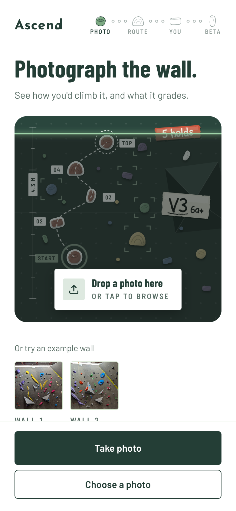
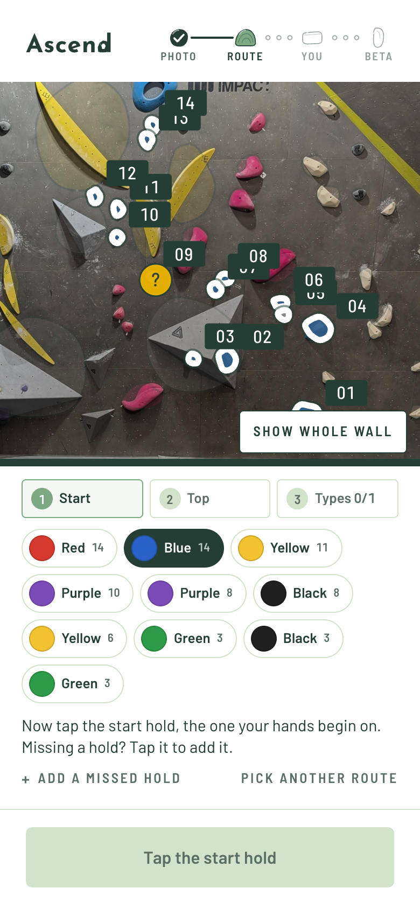
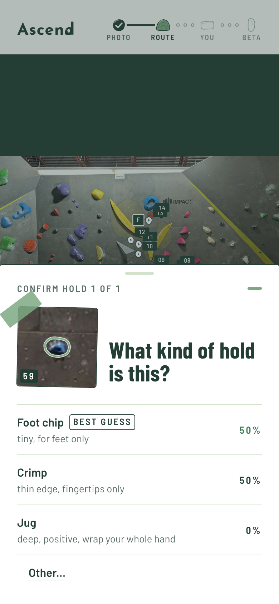
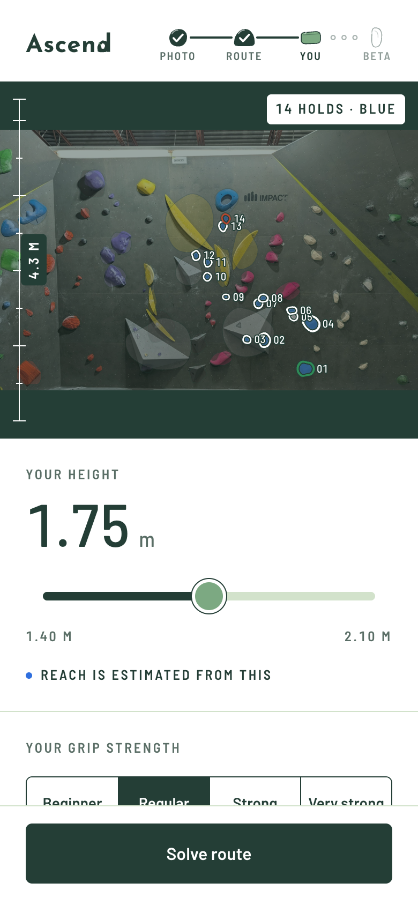
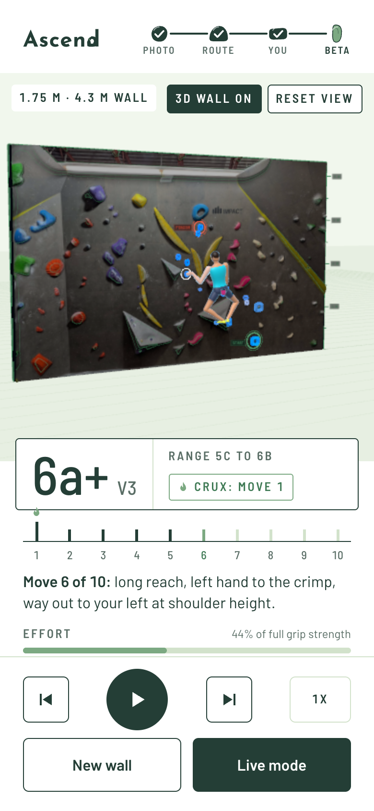

<div align="center">


# Ascend

**Photograph a climbing wall. See how you'd climb it, and what it grades.**

Ascend finds every hold in a photo of a gym wall, works out how a climber of
*your* height and strength would climb your chosen route (hands, feet and
physics), shows it in 3D, grades it, and then a voice coach talks you up it
while your phone camera follows you.

[**Live app → ascend-climb.vercel.app**](https://ascend-climb.vercel.app) ·
[Demo video](frontend/handoff-demo/videos/ascend-demo.mp4) ·
[How it works](#how-it-works) ·
[Results](#results)

Built in a weekend for **Imperial AI Week** · Track 03: Voice, Vision & Generative Media

</div>

<table>
  <tr>
    <td align="center" width="20%"><br /><sub><b>1. Photo</b><br />Snap or upload a wall</sub></td>
    <td align="center" width="20%"><br /><sub><b>2. Route</b><br />Every climb found, by colour</sub></td>
    <td align="center" width="20%"><br /><sub><b>3. Check</b><br />Only the unsure holds</sub></td>
    <td align="center" width="20%"><br /><sub><b>4. You</b><br />Height and grip strength</sub></td>
    <td align="center" width="20%"><br /><sub><b>5. Beta</b><br />3D climb, grade, effort</sub></td>
  </tr>
</table>

<sub>Screenshots taken from the app running locally against the real backend, on the example gym wall (blue route).</sub>

---

## Why

Every climber has stood under a problem wondering how to start it, and whether
"blue V3" here means the same as V3 down the road. Grades are one setter's
opinion, set for an average-height climber. Boards like the MoonBoard and
Kilter have tens of thousands of graded climbs, but that knowledge has never
reached an ordinary gym wall. Ascend points a phone at any wall and gives you
the beta, a grade and a coach, worked out for your body.

## What it does

| | |
|---|---|
| 🧗 **Finds every hold** | A fine-tuned detector finds the holds in your photo and labels each one's colour and type (jug, crimp, sloper, pinch, pocket, volume). |
| 🎨 **Groups the climbs** | Gyms colour-code routes, so Ascend lists every climb it found as colour chips. Pick one (or two if shadows split it), then tap the start and top holds. Colour names come from the photo, so it works for colourblind climbers too. |
| ❓ **Asks only what it must** | Confident hold types are filled in silently. For the few it's unsure of, it shows a close-up and its top guesses: a couple of taps, not the whole wall. |
| 🧠 **Solves the climb for you** | Set your height (1.40–2.10 m) and grip strength. A solver picks the *safest* sequence of hand moves, places the feet, and a physics model checks every position: effort per move, chance of falling, and the chance of reaching the top. Change your height or strength and the climb re-solves. |
| 🧊 **Shows it in 3D** | A depth model turns the photo into a 3D wall, and a jointed 3D climber animates the moves. Tap through move by move, with a plain-English description of each. |
| 📈 **Grades it** | A gradient-boosted model turns the solved sequence into a Font and V grade with a likely range, and marks the crux. |
| 🎙️ **Coaches you live** | An ElevenLabs voice agent calls your next move like a coach on the mat ("big move, right hand to the next jug up"). In Live mode the phone camera tracks your hands and feet in the browser, marks each move done as you reach the hold, and the coach moves on by itself. |
| 🔁 **Gets better with every climb** | Every climb the camera follows is saved, shown again as "Climbs like this" on similar routes, and can be added to the physics training data. |

## How it works

```
photo ──POST /analyze──► holds (box, type, quality, colour) + routes (colour groups)
      ──POST /depth────► relief map ──► 3D wall mesh
                               │
     you pick a colour, start hold, top hold; confirm unsure hold types; set height + strength
                               ▼
      ──POST /solve────► moves (LH/RH/LF/RF onto holds), 3D poses, physics per position,
                         chance of reaching the top, grade + range, crux
                               │
  app: 3D viewer plays it · voice coach reads it · live camera tracks you through it
                               │
      ──POST /climbs───► every followed climb stored ──► "Climbs like this" + physics retraining
```

| Part | Folder | Stack |
|---|---|---|
| **Frontend**: the Ascend app (mobile-first, installable PWA) | [`frontend/`](frontend/) | React 19, Vite, Tailwind v4, TypeScript; MediaPipe Pose in the browser; designed in Figma |
| **Backend**: hold finding, routes, solver, physics, grade, depth, API | [`backend/`](backend/) | Python, FastAPI, PyTorch, Ultralytics YOLO11, LightGBM, Depth Anything V2, three.js viewer |
| **API contract**: the shapes frontend and backend share | [`contract/`](contract/) | JSON examples made by the real backend |
| **Voice coach**: ElevenLabs agent + browser-side tools | [`coach/`](coach/) | ElevenLabs Agents, plain JS (36 tests) |
| **Adaption dataset**: "climb description → grade" for fine-tuning | [`adaption/`](adaption/) | Python |

The backend keeps no state: the app sends the whole route with every call, and
every position is a pixel in your photo, so results draw straight onto it.

### The interesting bits

- **The solver** searches over hand positions and shows the **safest** sequence:
  the shortest path where each move costs −log(1 − chance of falling on it).
  Feet are then planned for each hand position, onto route holds or smearing on
  bare wall. The climber starts standing on the floor, never touches it again,
  and finishes with both hands on the top hold.
- **The physics** is a static 2.5D balance model of every position. Each hand
  or foot can only push or pull the ways its hold allows (a jug almost any way,
  a sloper only straight down), with a grip limit set by hold quality ×
  strength. Finding the balance is one small non-negative least-squares problem
  (about 50 µs per position). It was tuned against 22 recorded climbs by 11
  real climbers ([The Way Up](#data-and-models) dataset), and a new setting
  only ships if it wins on both a random split and a held-out-route split.
- **Height scales the wall, not the climber.** A shorter climber sees the same
  wall in bigger units, so every span is longer, and sequence, effort and grade
  all follow. The same wall is a different climb for a 1.55 m beginner and a
  1.90 m strong climber.
- **3D from one photo.** Depth Anything V2 gives depth; subtracting a wide blur
  leaves what sticks out of the wall, and each hold found by an outline model
  becomes a dome.
- **Live camera.** The phone stays where it took the wall photo. MediaPipe Pose
  tracks fingertips and toes; a move counts when a hand or foot reaches the next
  hold and stays 0.35 s. That drives the coach, and the climb (every limb
  landing on a hold, with timestamps) is saved to `POST /climbs`.

## Results

All numbers are on held-out data. Sources: [`backend/BENCHMARKS.md`](backend/BENCHMARKS.md),
`backend/results_*.json` and [`docs/numbers.md`](docs/numbers.md).

| What | Ascend | Baseline |
|---|---|---|
| **Hold detector**, 50 held-out ClimbInst photos (3,433 holds) | **95%** of holds found | 38% (zero-shot Grounding DINO) |
| **Hold detector**, 19 hand-labelled photos from two real gyms | **87%** found, 95% precision | — |
| **Hold type**, 2,737 held-out holds | **87%** top guess, **98%** in top three | 42% (most common type) |
| **3D relief**, 19 photos with every hold outlined | a hold pixel is raised above bare wall **94%** of the time | — |
| **Physics vs real climbers** (The Way Up, sequence match score) | **0.58** | 0.46 before tuning; human experts 0.61 |
| **Route grouping**, 8 photos with 68 labelled routes | **43%** come out as one clean group | 19% (similar-colour rule) |
| **Grade**, MoonBoard 2016 (20,710 problems) | **0.94** grade steps off | 1.67 (always guess the median) |
| **Grade**, Kilter Board (54,362 climbs) | **1.30** grade steps off | 3.74 |
| **Live tracker**, real indoor clip filmed from behind | climber found in **99.9%** of frames | — |

Grade error is the mean absolute error in Font grade steps (6a → 6a+ is one step).

### Honest limits

- **Grading real gym walls is not solved.** On a gym-style wall (The A, 110
  problems) the grade model is no better than guessing; the board results
  above don't transfer yet.
- **Route grouping is right about half the time**, which is why the app lets
  you pick and correct the climb instead of trusting it.
- **Small holds are often missed** (under 20 px: 46% found), and the
  detector's test walls overlap its training walls.
- **The physics is static:** no dynos or momentum, and sit starts (hands below
  about 60 cm) come out as impossible.
- **The live camera hasn't been tested on a full real route yet**, only on
  filmed clips and a fake camera.

## Try it

### Hosted

**[ascend-climb.vercel.app](https://ascend-climb.vercel.app)**. Open it on a
phone, pick an example wall or take a photo, and follow the steps.

The models need 3–4 GB of memory kept loaded, so the backend runs on a team
laptop's GPU and is made public through a Cloudflare tunnel; the frontend is a
static build on Vercel. The live site works while that laptop is running
`backend/go_live.sh`.

### Run it yourself

**Backend** (needs [uv](https://github.com/astral-sh/uv) and Python 3.13; the
trained weights are in git):

```bash
cd backend
uv venv .venv --python 3.13 && uv pip install --python .venv/bin/python -r requirements.txt   # once
./run.sh                                                                                      # http://localhost:8010
```

`http://localhost:8010/demo/3d.html` is a standalone 3D demo of the backend.
`/depth` downloads Depth Anything V2 Base (about 400 MB) on first use.

**Frontend** (Node 20+):

```bash
cd frontend
npx pnpm@10 install
npx pnpm@10 run dev          # http://localhost:8443, talks to the backend on port 8010
```

Set `VITE_API_URL` to point at another backend. Add
`VITE_ELEVENLABS_AGENT_ID=agent_...` to `frontend/.env.local` for the voice
coach; without it, the app reads each move aloud with the browser's own voice.
The agent id is kept out of this public repo; ask Zaki.

**Put it online from your laptop** (needs `brew install cloudflared` and
`npx vercel login` once):

```bash
cd backend && ./go_live.sh   # backend + Cloudflare tunnel + frontend build uploaded to Vercel; Ctrl-C to stop
```

**Voice coach** (Node 18+, nothing to install):

```bash
cd coach
node --test                     # 36 tests
node try_coach.mjs              # rehearse what the coach says, offline
node setup_agent.mjs --apply    # create/update the ElevenLabs agent (needs ELEVENLABS_API_KEY in coach/.env)
```

**Adaption dataset:** see [`adaption/README.md`](adaption/README.md). The
dataset is built; the fine-tune hasn't been run yet.

## Data and models

**Services**
- [ElevenLabs Agents](https://elevenlabs.io/docs): the voice coach, with client tools that run in the browser.
- [Adaption](https://docs.adaptionlabs.ai/): "description → grade" fine-tune (dataset prepared, not yet run).
- [Figma](https://www.figma.com/): UI design; the app began as a Figma Make export.
- [Vercel](https://vercel.com/) and [Cloudflare Tunnel](https://developers.cloudflare.com/cloudflare-one/connections/connect-networks/): hosting.

**Models**
- [Ultralytics](https://github.com/ultralytics/ultralytics) YOLO11s (detector), YOLO11s-seg (hold outlines) and YOLO11n-cls (hold types), fine-tuned by us (AGPL-3.0).
- [Depth Anything V2 Base](https://huggingface.co/depth-anything/Depth-Anything-V2-Base): depth for the 3D wall (CC BY-NC 4.0).
- [IDEA-Research/grounding-dino-base](https://huggingface.co/IDEA-Research/grounding-dino-base) (Apache-2.0): zero-shot baseline and fallback hold finder.
- [MediaPipe Pose](https://developers.google.com/mediapipe): body tracking in the browser for Live mode.
- LightGBM grade model and the physics settings, trained by us.

**Datasets**
- **MoonBoard 2016** problems and hold scores from [MoonBoardRNN](https://github.com/jrchang612/MoonBoardRNN) (Duh and Chang, 2020; Apache-2.0 repo of data scraped from moonboard.com). Setter names and other personal fields dropped.
- **Kilter Board** climbs from [Vilin97/KilterBoard](https://huggingface.co/datasets/Vilin97/KilterBoard) (MIT).
- **[ClimbVision/ClimbInst](https://huggingface.co/datasets/ClimbVision/ClimbInst)** (CC BY-NC-SA 4.0): hold detector training and test photos.
- **[Indoor Climbing Gym Hold Classification Dataset](https://www.kaggle.com/datasets/diegospaziani/indoor-climbing-gym-hold-classification-dataset)** by Diego Spaziani (CC BY-SA 4.0): hold types. Re-split by original photo, because the source had augmented copies of the same photo across its splits.
- **The Way Up**: 22 recorded climbs by 11 climbers, used to tune the physics.
- **[Indoor Climbing Gym Hold And Route Segmentation](https://www.kaggle.com/datasets/tomasslama/indoor-climbing-gym-hold-segmentation)** by Tomáš Sláma: photos in `wall training images/` (not used by the shipped models).

## Team

| | Built |
|---|---|
| **Krishna Trehan** | Backend and ML: hold detection and types, routes, solver, physics, grade model, 3D, API, hosting |
| **Adam Wilkinson** | Frontend and product design: the Ascend app, its screens and look, the demo video |
| **Zaki Bawany** | Voice coach, Adaption dataset, demo and presentation |

## Licence

No licence has been chosen for this repository yet. Note that the hold
detector's training data and the depth model are non-commercial
(CC BY-NC-SA 4.0 and CC BY-NC 4.0), and Ultralytics models are AGPL-3.0.
